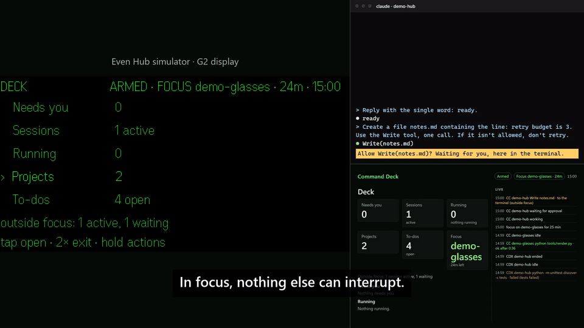

# Command Deck

Run your Claude Code and Codex sessions from Even Realities G2 glasses: see what is running and what
needs you, approve or deny a prompt with a tap, and focus on one project while the rest wait in
their terminals.



**Quickstart** (details under [Install](#install)):

1. Start the relay on your PC: `python relay/relay.py`
2. Add the hooks to a project: `python scripts/install_hook.py --deck --settings <project>/.claude/settings.json`
3. Pair the glasses: `python relay/gatectl.py pair --label glasses`, then open the printed link in the Even app (or in `evenhub-simulator`)
4. On the glasses, long-press the Deck and choose **Arm / Disarm**. Prompts now come to you.

Read the [threat model](#threat-model) before you arm it. The [90-second demo](demo/command-deck-demo.mp4)
shows every screen below, live against real Claude Code and Codex sessions in the Even Hub simulator.

Command Deck grew out of Approval Gate, which put only the permission prompt on the glasses. That
loop is unchanged: the same hook, contract and safeguards.

```
Claude Code / Codex ──PermissionRequest──▶ gate hook ──POST /requests──▶ relay ◀──GET /pending── plugin ──▶ glasses
                    ◀──allow / deny / nothing──────────────────────────  relay ◀──POST …/decide── plugin ◀── tap / double-tap
                    ──every hook event──▶ ingest (127.0.0.1:8798) ──▶ registry ──▶ /deck, /sessions, /runs… ──▶ glasses, phone page
                                                                                └─▶ desktop page and /present (127.0.0.1:8799)
```

| Piece | Runs on | What it is |
|---|---|---|
| `hook/approval_gate_hook.py` | PC | The `PermissionRequest` hook for Claude Code and Codex. Stdlib Python, run with `-I`. |
| `hook/deck_ingest.py` | PC | Forwards hook events to the relay's ingest port, for Codex and for Claude Code's SessionStart. Fire-and-forget, 2 s. |
| `relay/relay.py` | PC | The only thing the phone talks to. Stdlib `http.server`: the gate, the deck registry (`deck.py`, `projects.py`, `deck_api.py`), the ingest listener and the desktop page. |
| `relay/gatectl.py` | PC | Pair and revoke devices, arm and disarm, status, log. |
| `plugin/` | phone + glasses | The Even Hub plugin: Vite, TypeScript, `@evenrealities/even_hub_sdk`, `@evenrealities/pretext`. |
| `web/` | PC browser, phone | One UI module for the desktop page, the presenter view and the plugin's phone page. No build step. |

The pieces share no code, only [contract.md](contract.md). Where the code differs from the build
plans, and why, is in [docs/plan-deltas.md](docs/plan-deltas.md).

## Requirements

- A Windows PC with Python 3.12+, Node 20.17+, Claude Code (tested with 2.1.306), and optionally
  Codex (tested with 0.162.1).
- Tailscale on the PC and the phone, with MagicDNS and HTTPS certificates enabled on the tailnet.
- An Even Realities G2 with the Even app 2.2.10+. Or no glasses: `evenhub-simulator` runs everything
  on the PC.

## Install

### 1. Run the relay

```powershell
python relay/relay.py      # gate and phone API on 127.0.0.1:8797, ingest on 8798, desktop page on 8799
```

State lives in `%APPDATA%\approval-gate`. Every listener is loopback only. The relay refuses to bind
`0.0.0.0`, and disarms the gate when it stops.

### 2. Tell it about your projects

Create `%APPDATA%\approval-gate\deck.projects.json` (or pass `--projects <file>`):

```json
{
  "projects": [
    { "id": "glasses", "name": "glasses", "root": "H:/glasses", "todos": ["TODO.md"] },
    { "id": "hub", "name": "hub-orch", "root": "C:/dev/hub", "todos": ["obsidian:Projects/Hub.md"] }
  ],
  "obsidian_vault": "C:/vault",
  "unmapped": "other"
}
```

A session in a folder under a `root` belongs to that project, and so does a git worktree of it.
Sessions anywhere else are grouped as `(other)` and show only their folder name, or are hidden with
`"unmapped": "hide"`. `todos` lists the files whose `- [ ]` lines become to-dos. These are the only
files the glasses can ever change. This file stays on the PC.

### 3. Let the phone reach it

```powershell
tailscale serve --bg --https=443 http://127.0.0.1:8797
```

This publishes port 8797, and only 8797, to your tailnet at `https://<pc>.<tailnet>.ts.net`, with a
real certificate. Never serve 8798 (ingest) or 8799 (desktop page).

### 4. Pair the phone

```powershell
python relay/gatectl.py pair --label phone --relay-url https://<pc>.<tailnet>.ts.net `
    --plugin-url http://<tailnet-ip>:5180
```

This prints the device token once, plus a link that carries the relay URL and the token. The PC
stores only a hash of the token. `gatectl.py devices` lists paired devices, and
`gatectl.py revoke dev_…` unpairs one.

### 5. Install the plugin

The plugin's `network` whitelist is fixed into the package when it is built, and your relay's
address is yours alone, so every user builds their own. There are two ways to do it.

**A. Sideload the dev build.** This is the quickest; the PC serves the plugin:

```powershell
cd plugin
npm install
$env:GATE_DEV_HOST = "<tailnet-ip>"; npm run dev    # serve the plugin on the tailnet only
npx evenhub qr --url "<link from step 4>"           # scan with the Even app
```

**B. Pack your own `.ehpk`**, with your relay in the whitelist:

```powershell
cd plugin
npm install
npm run pack -- --relay https://<pc>.<tailnet>.ts.net --id com.<you>.commanddeck
```

This writes `app.local.json` (gitignored), whitelists only your relay, builds, and runs
`evenhub pack`. To install the package, use your own Even Hub developer account:

1. `evenhub login`
2. `evenhub create`
3. `evenhub promote <version> --to beta`
4. `evenhub testers add <your email>`
5. Install the beta from the Even app.
6. Open the plugin's phone page and paste the relay URL and token under **Pairing**.

The phone page is the gate's mirror and pairing form. The full Command Deck phone page (sections,
timelines, "Open on phone") is behind a build flag and off by default:
`$env:VITE_DECK_PHONE = "1"` before `npm run dev` or `npm run pack`. See the threat model.

Whether Even will list one shared build is an open question in
[docs/discord-questions.md](docs/discord-questions.md).

### 6. Register the hooks

```powershell
python scripts/install_hook.py --deck --settings <project>/.claude/settings.json          # one project
python scripts/install_hook.py --deck --codex --settings <project>/.codex/hooks.json      # Codex, same project
python scripts/install_hook.py --deck                                                     # every project: ~/.claude/settings.json
python scripts/install_hook.py --uninstall --settings <file>
```

The gate hook goes on `PermissionRequest` (matcher `Bash|Write|Edit`, or `Bash|apply_patch` for
Codex, timeout 100). `--deck` adds the telemetry:

- **Claude Code** gets `http` hooks that post every event to the ingest port with a 2 s timeout.
  SessionStart, which Claude Code can't send over `http`, goes through `hook/deck_ingest.py`.
- **Codex** gets `hook/deck_ingest.py` with `async: true`.

The ingest key reaches Claude Code as `DECK_INGEST_TOKEN` in the `env` of `settings.local.json`,
never in a committed `settings.json`. A dead relay costs an agent nothing. The installer keeps a
`.approval-gate.bak` copy and leaves your other hooks alone.

For Codex, open `/hooks` in the session and trust the new hooks. Codex skips new or changed hooks
until you do, and loads a project's `.codex/` only in a trusted project. If your config uses
automatic review, start Codex with `-c approvals_reviewer=user` so approvals come to you.

### 7. Optional: a disarm hotkey

```powershell
$s = (New-Object -ComObject WScript.Shell).CreateShortcut(
    "$env:APPDATA\Microsoft\Windows\Start Menu\Programs\Command Deck - disarm.lnk")
$s.TargetPath = (Get-Command pythonw).Source
$s.Arguments = '"<repo>\relay\gatectl.py" disarm --source hotkey'
$s.Hotkey = "CTRL+ALT+D"
$s.Save()
```

## Use

The G2 shows the glance and the decision. The desktop page and the phone page carry the detail.

**Gestures**, the same on every screen. The hint line names what tap does on each one.

| Gesture | Lists | Detail screens | A prompt |
|---|---|---|---|
| Swipe up / down | Move the highlight (›) | Scroll | Full command / summary |
| Tap | Open the row | The one action on the hint line | Approve, once the prompt has been up 0.7 s |
| Double-tap | Back; at the Deck, exit (disarming first) | Back | Deny |
| Long-press | Actions for the highlighted row | Actions for this item | Off |

Every tap waits 0.35 s in case it is half of a double-tap. Every screen ignores taps for its first
0.7 s.

**Screens:**

- **Deck.** Needs you, Sessions, Running, Projects, To-dos and Focus, with live counts. The status
  bar shows where you are, ARMED or OFF, the focus block, and the clock. A failed tool call or an
  API error pins a FAILED row to the top until you open it.
- **Needs you.** Live prompts first, then sessions waiting in their own terminal, then cards.
- **Sessions.** One row per agent session (`CC` Claude Code, `CDX` Codex), waiting first. A session
  opens to its state, its current tool and its counts.
- **Running.** Every open tool call and subagent, oldest first, in whole minutes. A run opens to a
  clock that ticks every second.
- **Projects.** Each project opens as a Deck of its own, with its branch, dirty files and recent
  commits.
- **To-dos.** The `- [ ]` lines of each project's files, plus Claude Code's own task list. Open one
  and tap again to mark it done. Exactly that one line becomes `- [x]`. If the line changed since it
  was read, nothing is written.
- **Focus.** Pin one or two projects for 25 min, 50 min or no timer. Everything outside focus
  leaves the glasses: its prompts go straight to their terminals, and its sessions show only as a
  dim count. When focus ends you get a summary (minutes, approvals, runs finished, to-dos done).
- **Since you looked.** When you open the plugin, one screen shows what finished, failed or fell
  back to the terminal while it was closed.

**Prompts outrank everything.** A permission prompt takes the screen from any depth. After you
answer, you are back on the same row. The prompt shows the session, the tool, a countdown, the
hook's one-line summary and `HIGH RISK` when it applies. A deny tells the agent why and asks it not
to retry.

**The desktop page** at `http://127.0.0.1:8799/` has the same sections, plus a timeline for each
session and a live ticker. It is read-only, and paths stay hidden until you click them.
**`/present`** is the Deck at 1920×1080 with large type, and it follows whatever page the glasses
show. **Cards:** any script on the PC can post one to Needs you:

```powershell
$key = Get-Content "$env:APPDATA\approval-gate\ingest.key"
Invoke-RestMethod -Method Post -Uri "http://127.0.0.1:8798/ingest?agent=claude-code" `
  -Headers @{ Authorization = "Bearer $key" } -ContentType application/json `
  -Body '{"type":"card","title":"Nightly build failed","project":"glasses","level":"error"}'
```

`python relay/gatectl.py log` shows recent gate outcomes. `status` shows the armed state, and
`arm` and `disarm` work from the PC. Records are kept in `gate.log` (the gate) and `deck.log`
(sessions, runs, focus).

## Threat model

Command Deck is a remote control for commands on your PC, and a live map of your work. Read this
before arming it.

**What it protects.** Your shell and files, which the agents act on. The credentials that can
approve: device tokens on the phone, and `hook.key` on the PC. And the shape of your work (project
names, paths, commands), which the deck makes visible.

**Who it assumes might misbehave:**

- **The agent.** A model can be wrong or prompt-injected. It can try to label a command as
  something else, hide it in a long chain, or reach for credentials.
- **Other devices on your tailnet.** They can reach the relay, but they hold no token.
- **Web pages in your browser.** They can send requests to localhost.
- **Time.** A stale prompt, a replayed decision, or a phone that went to sleep mid-prompt.

**What the gate does** (unchanged from Approval Gate):

- **Silence means terminal.** Timeout, malformed input, unknown id, relay down or restarted, gate
  disarmed, nobody watching, outside focus, a muted session: in every one of these cases the hook
  prints nothing, and the agent shows its own prompt. No error path prints `allow`.
- **The glasses can never approve these.** The hook sends them straight to the terminal:
  - `rm -rf` and its Windows equivalents, `git push --force`, `git reset --hard`, `git clean -f`
  - `sudo`/`runas`, `curl | sh`, `iex`, `eval`, `base64 -d`
  - anything touching `.ssh`, `.env`, `settings.json`, `.claude/`, `.git/hooks`, credential files,
    or the gate's own files
  - commands with invisible or bidi characters
  - commands too long to show in full (over 200 characters)
- **The glasses show the hook's summary.** The hook builds it from `tool_input`, never from the
  agent's description. In a long chain, the risky part leads (`rm -r build …+1`).
- **One decision per request.** The decision must echo a nonce, and expires after 90 s (45 s for
  high risk). A replayed, late or second decision gets `409`.
- **Nobody watching means terminal.** If no paired device has polled for 10 s, the relay refuses
  new requests and cancels pending ones. The relay disarms on stop, on plugin exit, and after 60 s
  with nobody polling.
- **No auto-approval, ever.** There is no "approve similar commands for N minutes", and muting a
  session sends its prompts to its terminal, never to an automatic yes.

**What the deck adds:**

- **Three credentials, each for one job.** `hook.key` creates gate requests. Device tokens decide
  them and read the deck. `ingest.key` can only post telemetry. Each gets `401` everywhere else.
- **Ingest is never on the tailnet.** It has its own port, 8798, on 127.0.0.1, which
  `tailscale serve` never publishes. A test checks that the phone port answers `404` to `/ingest`.
- **Nothing absolute leaves the PC.** The relay turns every path into a project-relative one at
  ingest. A path in no project becomes its last component, and the home directory never appears.
  Secret-shaped strings become `[secret]`. A test feeds hook fixtures full of `C:/Users/…` paths
  through every phone endpoint.
- **No agent text is stored.** Prompts, assistant messages, tool output and patch bodies are
  dropped at ingest. Codex's test output is read in its hook process, for a pass/fail flag, and
  never sent.
- **Writes are a closed list.** Approve or deny, arm or disarm, focus, to-do done, and mute (which
  only hides a session and routes its prompts to the terminal). The to-do write touches only files
  in `deck.projects.json`. It replaces exactly the one line whose hash matches, by temp file and
  rename. Nothing on the glasses, phone or desktop page runs a command.
- **The desktop page is loopback and read-only.** It refuses any `Host` but 127.0.0.1 or localhost
  (DNS rebinding), sends no CORS headers, has a strict CSP, and its event stream never counts as a
  device watching.
- **The phone page is off by default.** Public builds don't contain it. When it is on, paths are
  hidden until tapped, and the page blanks whenever the WebView goes to the background.
- **Caps.** Ingest parses at most 64 KB of a body. The registry keeps at most 200 sessions and
  2,000 runs, and `deck.log` rotates at 10 MB.

**What it does not protect against:**

- **Someone with your unlocked phone while the plugin is open.** They can read your project map,
  and with your glasses they can approve whatever comes in. So can anyone who pulls the device
  token out of the app. Disarm when you put the phone down, and revoke the device
  (`gatectl.py revoke`) if you lose it.
- **An agent posting telemetry.** Claude Code exports `DECK_INGEST_TOKEN` to the agent's own shell.
  With it, an agent can post fake session states or cards. It can't create or decide a prompt.
- **Harm done through files.** An agent can run a harmless-looking command that does damage through
  a script it wrote earlier. The glasses show the command, not what the script will do.
- **Clever disguises.** The denylist is pattern-based: a backstop, not a sandbox. A disguised `rm`
  reaches the glasses as what it literally says. The real check is you reading the summary.
- **A compromised PC, phone or Even app.** Whoever controls those controls the gate.

## Configuration

| Port | What | Exposed |
|---|---|---|
| 8797 | Gate and phone API (`relay.py --port`) | To your tailnet, through `tailscale serve` |
| 8798 | Ingest for hook telemetry (`--ingest-port`) | Never: 127.0.0.1 only |
| 8799 | Desktop page and `/present` (`--desktop-port`) | Never: 127.0.0.1 only |
| 5180 | Plugin dev server (Vite, `strictPort`; `GATE_DEV_HOST` to move off loopback) | Only if you set `GATE_DEV_HOST` |
| 9898 | Simulator automation API | Development only |

8787 and 5173, the obvious picks, were taken on the development PC. The hooks find the relay
through `relay.json`, so a port change needs no other edits. These files live in
`%APPDATA%\approval-gate` (or `APPROVAL_GATE_HOME`):

| File | What |
|---|---|
| `armed` | Present while the gate is armed. The hook checks only this. |
| `hook.key`, `ingest.key` | The gate hook's and the telemetry's credentials, created on first start. |
| `devices.json` | Paired devices: id, label, token hash. |
| `relay.json` | The running relay's URLs and pid. |
| `deck.projects.json` | Your projects. Never sent anywhere. |
| `gate.log` | JSONL: requests, decisions, arm and disarm. |
| `deck.log` | JSONL: sessions, runs, approvals, focus blocks, to-dos done. Rotates at 10 MB. |
| `focus.json` | The focus block in progress, so it survives a restart. |

## Develop

The devstack runs the relay, Vite and the simulator against a throwaway state directory
(`C:/deck-sandbox/state`), so your own pairing and logs are untouched:

```powershell
python scripts/devstack.py up            # relay, Vite (phone page on), simulator, paired
python scripts/devstack.py seed          # live sessions in two scratch projects, from real hook fixtures
python scripts/sim.py run walk           # also: interrupt, running, tick, since, todo, focus, desktop
python scripts/devstack.py down
```

Each `sim.py run` drives the simulator through its automation API and fails on any console error.
`running` and the demo use real Claude Code and Codex sessions.

Tests:

```powershell
python -m unittest discover -s relay     # gate, registry, scrubbing, ingest, focus, to-dos, desktop page
python -m unittest discover -s hook      # rules and redaction, plus the real hook against a live relay
python -m unittest discover -s scripts   # demo cut, hardware checklist
cd plugin; npm test; npx tsc --noEmit    # gestures, screens, pixel fitting, types
```

The hook fixtures in `tests/fixtures/hooks/` are real Claude Code and Codex payloads with the home
directory scrubbed (see the README there). Everything was built against `evenhub-simulator` 0.9.5.
What only a G2 can confirm is listed in [docs/hardware-checklist.md](docs/hardware-checklist.md),
and marked `HARDWARE:` in the code.

## Demo

The demo is reproducible from a cold start, and every action in it is live:

```powershell
python scripts/demo_stage.py              # two throwaway repos in C:/deck-sandbox/demo, project-level hooks, the stack
python scripts/demo_run.py                # rehearse: drive every beat and check the outcomes
python scripts/demo_stage.py --reset      # back to the start, in about 15 s
python scripts/demo_run.py --record       # record, then cut into demo/
python scripts/demo_run.py --cut          # re-cut after editing demo/captions.srt
python scripts/demo_stage.py --teardown
```

`demo/` holds the video, `captions.srt`, six stills and `deck-loop.gif`. The glasses pane is the
simulator's own framebuffer. The right-hand panes are Chrome screencasts of `/present`, the
`TODO.md` file, and each agent's output stream. Nothing is captured from your screen. The raw take
stays in `C:/deck-sandbox/demo/take`, and a take whose capture stalls fails its checks and is not cut.

## License

MIT. See [LICENSE](LICENSE).
