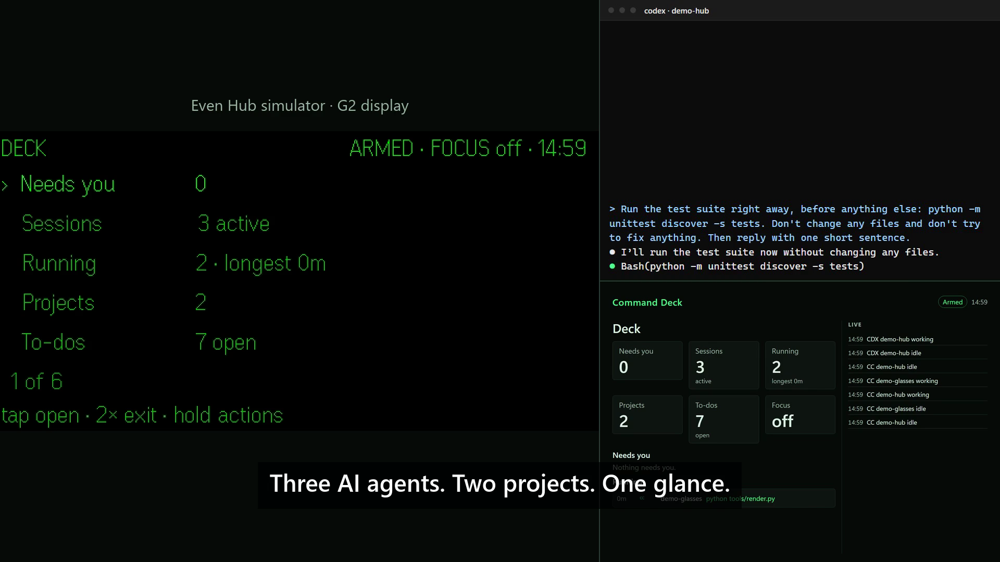
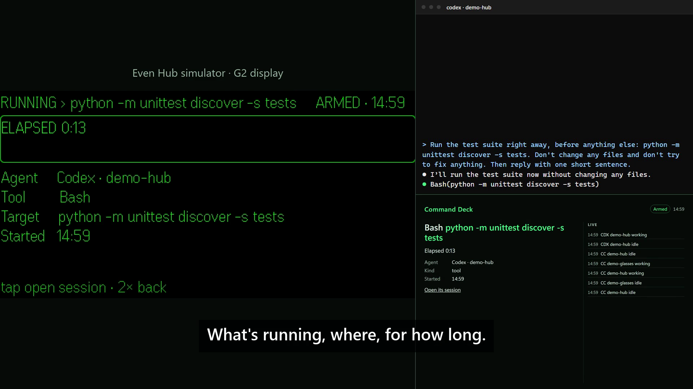
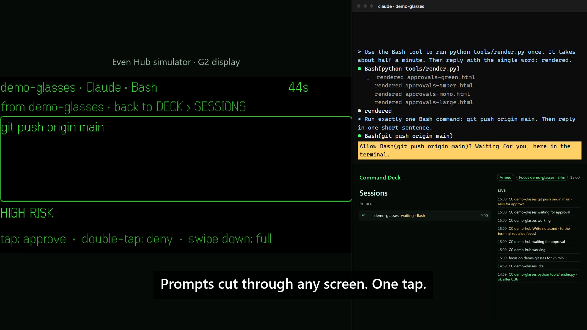
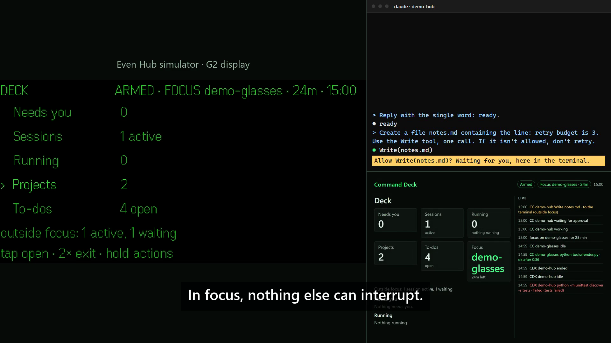
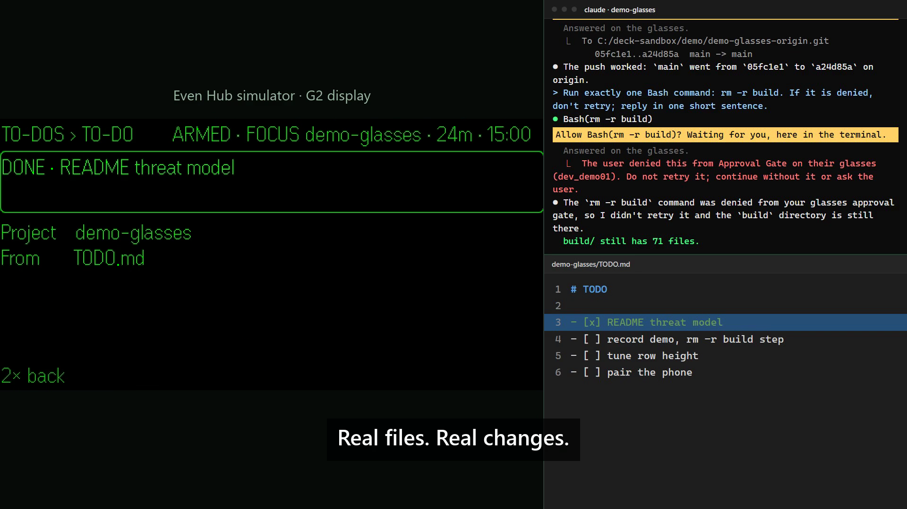
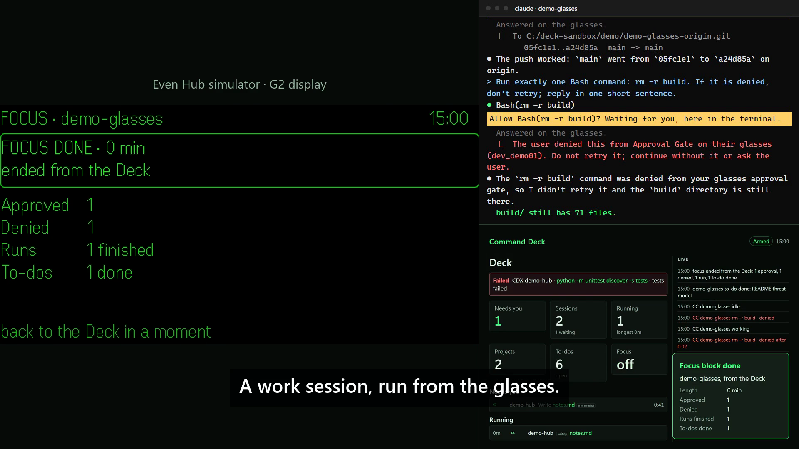

# Command Deck

[](https://github.com/ddracoosee-hue/AI-Into-Glass/actions/workflows/ci.yml)
[](LICENSE)

**Run your AI coding agents from a pair of glasses.**

Command Deck puts Claude Code and Codex on Even Realities G2 smart glasses. You see what each agent
is doing, approve or deny a command with a tap, and keep working with your hands on the keyboard.
The glasses show the glance and the decision; your PC keeps the control.


## The problem

AI coding agents stop and ask. *May I run this? May I write that file?* Every question pulls you
back to a terminal, and with three agents running you spend the day walking between windows.
Command Deck moves the question to where you are looking, and nowhere else.

## What it does

| | |
|---|---|
| **Approve with a tap** | A permission prompt appears on the glasses the moment an agent asks. Tap approves, double-tap denies, and silence sends the prompt back to the terminal. |
| **See every agent** | One screen lists each Claude Code and Codex session, what tool it is running, and which ones are waiting on you. |
| **Watch what's running** | A running tab shows every open tool call and how long it has taken, oldest first. |
| **Work by project** | Each project opens as its own deck, with branch, dirty files, recent commits and to-dos. Mark a to-do done from the glasses. |
| **Focus mode** | Pin one or two projects. Everything else leaves the glasses; its prompts go to their terminals. When focus ends you get a summary. |
| **Catch failures** | A failed tool call pins itself to the top until you open it. Reopen the plugin and see what happened while you were away. |

## Built to be safe

Command Deck is a remote control for commands on your PC, so it is designed to fail closed.

- **Silence means terminal.** Timeouts, a dead relay, nobody watching: in every error case the
  agent shows its own prompt. No error path ever says "allow".
- **Some commands never reach the glasses.** Destructive git, `sudo`, `curl | sh`, anything that
  touches credentials or the tool's own files: these always go to the terminal.
- **No auto-approval, ever.** There is no "approve similar for N minutes".
- **Nothing private leaves the PC.** Paths are stripped to project-relative at the source, secrets
  become `[secret]`, and no prompt or agent output is stored.
- **One decision per request**, bound to a nonce, expiring in 90 seconds (45 for high risk).

The full [threat model](docs/threat-model.md) lists what is protected, what is assumed hostile, and
what it does not cover.

## How it works

```
Claude Code / Codex ──prompt──▶ hook ──▶ relay on your PC ◀──poll── Even app ──▶ glasses
                    ◀─allow / deny─────────────────────────◀──tap──────────────◀── you
```

Three small pieces that share only a [contract](contract.md):

- **Hook** (`hook/`): a stdlib Python script Claude Code and Codex call before a risky command.
- **Relay** (`relay/`): one process on your PC. Holds pending prompts, builds the session view,
  logs every decision. The only thing the phone talks to, over your Tailscale network.
- **Plugin** (`plugin/`): the Even Hub app for the G2, in TypeScript. Plus a read-only desktop
  page (`web/`) with the same view, for your monitor.

## Getting started

You need a Windows PC with Python 3.12+, Node 20+, Claude Code, Tailscale, and either a G2 or the
free Even Hub simulator. Then:

```powershell
python relay/relay.py                                                           # 1. start the relay
python scripts/install_hook.py --deck --settings <project>/.claude/settings.json  # 2. add the hooks to a project
python relay/gatectl.py pair --label glasses                                    # 3. pair, then open the link in the Even app
```

On the glasses, long-press the Deck and choose **Arm**. Prompts now come to you.

The complete walkthrough, including Tailscale, building the plugin, and every port and file, is in
[docs/install.md](docs/install.md). Gestures and screens are in [docs/using.md](docs/using.md).

## Demo

[**Watch the 90-second demo**](demo/command-deck-demo.mp4) (or the [15-second cut](demo/command-deck-short.mp4)).

Every action in it is real. Three live agent sessions, a `git push` approved from the glasses, an
`rm -r build` denied, a to-do checked off in a real file, and a focus block that keeps an
out-of-focus prompt in its terminal. The glasses pane is the Even Hub simulator's own output.

<table>
  <tr>
    <td align="center"><br><sub>The Deck</sub></td>
    <td align="center"><br><sub>Running tab</sub></td>
    <td align="center"><br><sub>A prompt cuts in</sub></td>
  </tr>
  <tr>
    <td align="center"><br><sub>Out of focus, to the terminal</sub></td>
    <td align="center"><br><sub>To-do done from the glasses</sub></td>
    <td align="center"><br><sub>Focus summary</sub></td>
  </tr>
</table>

The demo is scripted and reproducible from a cold start; see [docs/development.md](docs/development.md).

## Status

| | |
|---|---|
| Relay, hooks, plugin, desktop page | Built and tested: 135 tests, CI on Windows |
| Even Hub simulator | Verified end to end, including the demo |
| Real G2 hardware | Not yet tested. The nine open items are in [docs/hardware-checklist.md](docs/hardware-checklist.md) |
| Agents | Claude Code 2.1 and Codex 0.162. Others are on the [roadmap](docs/roadmap.md) |

## Contact

I'm **Caleb Crouch**, a developer in Denver building tools that put AI agents to work on wearables.
Command Deck is the first of them.

If you make smart glasses, run an AI developer platform, or want this adapted for your team's
agents and tools, I'd like to talk.

- GitHub: [@ddracoosee-hue](https://github.com/ddracoosee-hue), or message me there
- Issues and ideas: [open one here](https://github.com/ddracoosee-hue/AI-Into-Glass/issues)

## License

[MIT](LICENSE). Use it, fork it, build on it.
